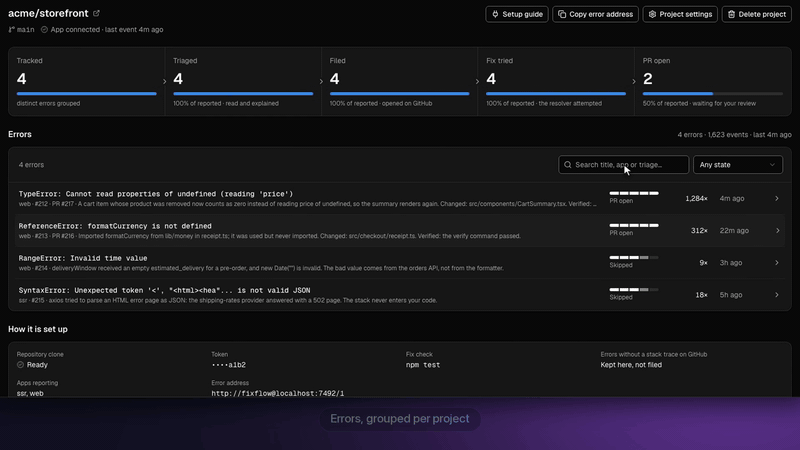
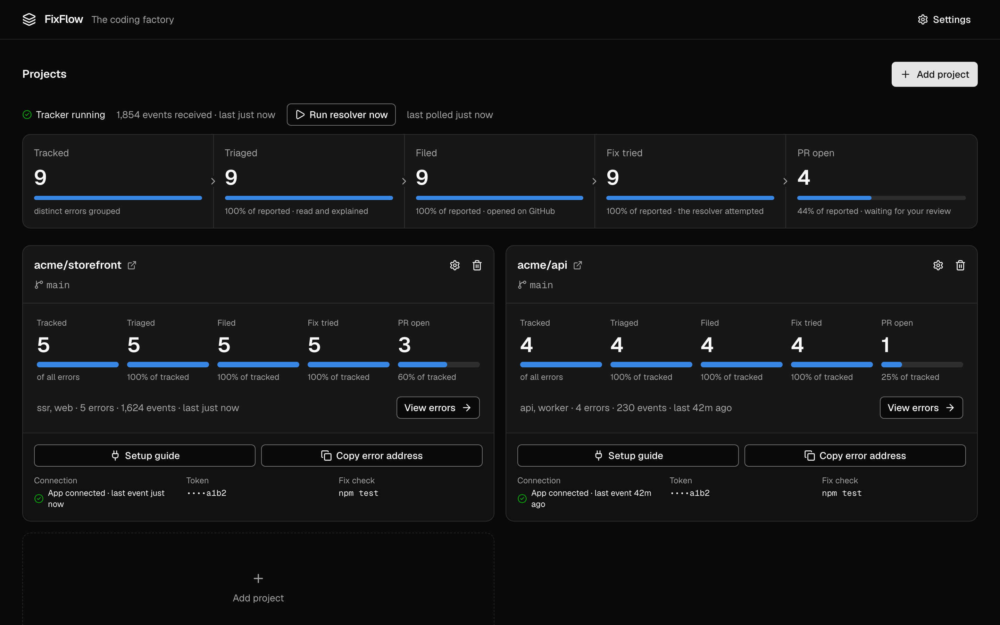
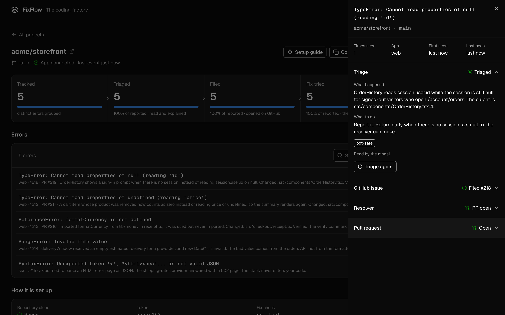
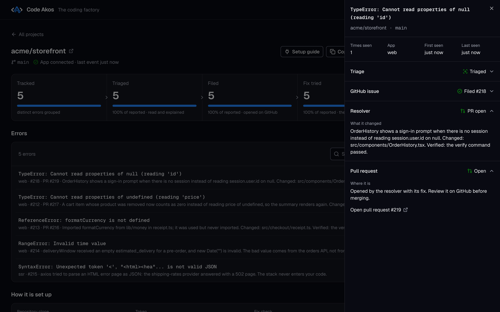
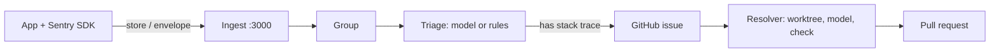

# FixFlow

FixFlow is self-hosted, Sentry-compatible error tracking. It groups the errors your app's Sentry SDK sends, opens a GitHub issue for each new one, and has an LLM attempt a fix that it opens as a pull request for you to review. The model runs locally through Ollama (default `qwen2.5-coder:7b`) or through the DeepSeek or Anthropic API.

[](LICENSE)
[](https://github.com/Ayesh96/FixFlow/actions/workflows/ci.yml)
[](https://github.com/Ayesh96/FixFlow/releases/latest)
[](https://github.com/Ayesh96/FixFlow/stargazers)



[Watch the one-minute demo](https://github.com/user-attachments/assets/5e524299-858a-46d1-950a-6e437657eb0e) (setup wizard, then an error going all the way to a pull request).

## The problem

Between an exception in production and a fix, someone has to group duplicates, write the issue, find the cause and open a pull request. Sentry automates the last steps with Seer on its paid plans, and self-hosted Sentry is a Docker Compose stack of 53 services that needs 16 GB of RAM. FixFlow covers the whole path in one Node process with SQLite, on your machine, with a model you choose.

## Quick start

Needs Node 24+ and git, on Linux or macOS. Windows is not tested.

```bash
git clone https://github.com/Ayesh96/FixFlow.git && cd FixFlow
npm install     # also installs the UI's dependencies
npm start       # builds the UI if it is stale, then serves it
```

The first `npm start` in a terminal runs a short setup and writes `.env`. It asks for the dashboard port, a data folder, at least one model and the error-tracking and resolver settings. It tests the Ollama address and verifies API keys, offers only the models they actually have, checks the ports are free, and runs the result through the server's own config checks before writing anything. Change the settings later with `npm run setup`, which starts from the current `.env`.

`npm start` then prints `http://localhost:7420/?token=…`. Open it once; the token is then kept in an HttpOnly cookie. From another terminal, `curl -s -o /dev/null -w '%{http_code}\n' http://localhost:3000/healthz` prints `200` when ingest is up.

1. **Projects → Add project**: `owner/name`, a GitHub token, the branch to work on, and optionally a check command such as `npm ci && npm test`.
2. Set your SDK's `dsn` to the project's DSN, for example `http://fixflow@localhost:3000/1`.
3. Errors appear on the project's page (**View errors** on its card). Those with a stack trace are filed as GitHub issues.

From a [release tarball](https://github.com/Ayesh96/FixFlow/releases/latest) there is no build step: check it with `sha256sums.txt`, unpack, and run `node bin/fixflow.mjs`. The first run asks the same setup questions.

**Desktop app (macOS, Apple Silicon).** `cd desktop && npm install && npm run dist:mac` builds `desktop/release/FixFlow-1.0.0-mac-arm64.dmg`. The app runs FixFlow in its own bundled Node, so the machine needs no Node install. The first launch shows the same setup as a window, then opens the dashboard in a window. **Settings** in the dashboard header (or FixFlow › Settings…, ⌘,) reopens it with the current values; saving restarts FixFlow, and if it will not start with the new settings the old ones are put back. The build is ad-hoc signed, not notarized, so macOS blocks the first open of a downloaded copy until you allow it in System Settings › Privacy & Security.

**Models.** Triage works without a provider, using built-in rules. The resolver needs one. By default it tries Ollama at `http://localhost:11434` first (`ollama pull qwen2.5-coder:7b`), and also DeepSeek or Anthropic if you set `ORCH_DEEPSEEK_API_KEY` or `ORCH_ANTHROPIC_API_KEY`. See [configuration](docs/reference.md#configuration).

## Features

- **Sentry ingest.** The `store` and `envelope` endpoints, gzip, deflate or brotli bodies, and CORS for browser SDKs. You only change the DSN.
- **Grouping.** Exception type + crashing file + that frame's source line text (not its line number) or function name. Ids in the message and line-number shifts do not split a group. The SDK's `fingerprint` override is honoured.
- **Triage.** Tags each error `bot-safe`, `needs-human`, `infrastructure`, `third-party`, `no-stack-trace` or `test-event`, with a reason and a next step. Only `bot-safe` becomes a GitHub label.
- **GitHub issues.** One per new group that has a stack trace and level `error` or `fatal` (configurable). Comments when it reaches 100, 1,000 and 10,000 events.
- **Resolver.** For each open issue it filed, FixFlow fetches your branch, gives the model up to 20 tool-use turns in a throwaway worktree, runs your check command before and after, and opens a pull request marked verified or unverified. The model may answer `SKIP` instead.

The resolver does not read triage tags today: it attempts every open issue FixFlow filed, including ones tagged `needs-human` or `infrastructure`. With a paid API that costs money per attempt; a failing issue is tried at most 3 times.

## Screenshots

| Every project at a glance | What triage found | The pull request it opened |
|---|---|---|
|  |  |  |

More in [docs/assets/screenshots](docs/assets/screenshots), including the desktop setup wizard.

## How it works



Dashboard (`127.0.0.1:7420`) and ingest (`127.0.0.1:3000`) are separate sockets in one process, both on loopback by default. GitHub tokens are stored AES-256-GCM encrypted. Details: [reference](docs/reference.md).

## Compared with alternatives

| | FixFlow | Sentry | GlitchTip | Bugsink |
|---|---|---|---|---|
| Accepts Sentry SDK events | Yes | Yes | Yes | Yes |
| Self-hosted footprint | 1 Node process, SQLite | Docker Compose, 53 services incl. Kafka and ClickHouse; 4 cores, 16 GB RAM + 16 GB swap minimum | 1 service + PostgreSQL; 256 MB RAM minimum | 1 container; SQLite, MySQL or PostgreSQL |
| Creates GitHub issues | Automatically | Manually (Team plan); from alert rules (Business plan and up) | Not in its docs | Not in its docs |
| Opens fix pull requests | Yes, your model | Seer, on paid plans: $40 per active contributor per month | No | No |
| Alerts | No | Yes | Email, webhooks | Slack, Discord, Teams, Mattermost, Telegram, webhooks |
| Tracing, session replay | No | Yes | Not in its docs | Not in its docs |
| Multi-user | No | Yes | Yes | Yes |
| License | FSL-1.1-ALv2 | FSL-1.1-Apache-2.0 | MIT | Custom (see its repo) |

Facts about other tools are from their docs as of October 2026. Choose Sentry for tracing, alerting and teams. Choose GlitchTip or Bugsink for a small multi-user tracker without automated fixes. Choose FixFlow for one maintainer who wants errors turned into reviewable pull requests on their own machine.

Triage was measured on 12 replayed cases ([results](docs/TRIAGE-BEFORE-AFTER.md)). Fix success rate has not been measured.

## Roadmap

No committed roadmap. Known gaps:

- The resolver ignores triage tags (see above).
- No measured fix success rate.
- Windows untested; no container image.

Bugs and ideas: [issues](https://github.com/Ayesh96/FixFlow/issues).

## Contributing

See [CONTRIBUTING.md](CONTRIBUTING.md). Sign off commits (`git commit -s`) and run `npm run typecheck && npm test`.

## License

FixFlow is **source-available** under the [Functional Source License, version 1.1](LICENSE) (`FSL-1.1-ALv2`), not an OSI open-source license.

- You may **use, run, modify and self-host it**, including inside a company, for free.
- You may **not** use it to offer a competing commercial product or service.
- Each release converts to the **Apache License 2.0 two years after** it is published.

"FixFlow" is the name of this project; a fork has to use another name. To report a suspected violation, open an issue or contact the maintainer.
