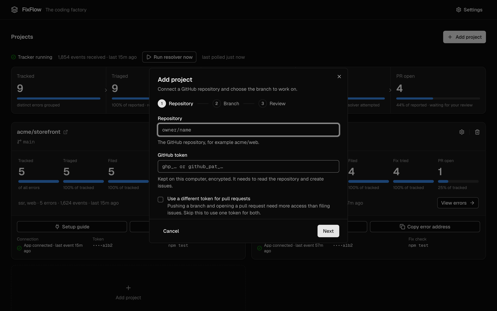

# Getting started

This guide takes you from a fresh install to your first automated pull request. It takes about ten minutes. You need FixFlow [installed and set up](installation.md), and an app written in Python, Node.js or JavaScript for the browser.

In FixFlow, a **project** is one GitHub repository and the branch you want fixes for. Each project gets its own address, called a **DSN**, which you give to the Sentry SDK in your app. You can add as many projects as you like.

## 1. Create a GitHub token

FixFlow needs a GitHub token to open issues and pull requests on your repository. Use a fine-grained personal access token, which can be limited to one repository:

1. On GitHub, open **Settings › Developer settings › Personal access tokens › Fine-grained tokens** and click **Generate new token**.
2. Under **Repository access**, choose **Only select repositories** and pick your repository.
3. Under **Permissions**, give it the following:

    | Permission | Access | Why |
    |---|---|---|
    | Contents | Read and write | To copy the code and push the branch with the fix |
    | Issues | Read and write | To open issues and comment on them |
    | Pull requests | Read and write | To open the pull request with the fix |

4. Generate the token and copy it. It starts with `github_pat_`.

!!! tip "Prefer two tokens?"
    Filing issues only needs **Contents: read** and **Issues: read and write**. If you don't want the main token to be able to push code, create a second token with the write permissions and use it only for pull requests. The Add project window has an option for this.

## 2. Add the project

{ loading=lazy width="2880" height="1800" }

In the dashboard, click **Add project**. The window has three steps.

1. **Repository.** Enter the repository as `owner/name`, for example `acme/storefront`, and paste your token. Tick **Use a different token for pull requests** if you made a second token.
2. **Branch.** Choose the branch FixFlow should work on, usually `main`. Errors are filed against it, fixes start from its latest commit and pull requests are opened against it.

    You can also enter a **command to check a fix**, such as `npm ci && npm test` or `pytest`. FixFlow runs it before and after every fix. A pull request whose check passed is marked *verified*. Without a command, pull requests are marked *unverified*. The command runs on your computer as you, so only enter something you would run yourself.

3. **Review.** Check the details and click **Add project**.

FixFlow checks the token with GitHub before saving it, stores it encrypted on your computer and makes a copy of the repository in the background.

## 3. Connect your app

Click **Setup guide** on the project's card. The guide shows the code for Python, Node.js and the browser, with your project's DSN already filled in. It looks like `http://fixflow@localhost:3000/1`, where the number at the end is the project's ID.

{ loading=lazy width="2880" height="1800" }

If your app already uses Sentry, you only need to replace the `dsn` value. Otherwise, install the SDK and add the setup code where your app starts.

=== "Python"

    ```bash
    pip install sentry-sdk
    ```

    ```python
    import sentry_sdk

    sentry_sdk.init(
        dsn="http://fixflow@localhost:3000/1",
        environment="production",  # "development" on your own machine
        release="storefront@1.0.0",  # your version or git commit
        attach_stacktrace=True,  # logged messages carry the stack
    )
    sentry_sdk.set_tag("service", "storefront")  # names the app on every error
    ```

    Put this at the top of your entry file, before the app is created. Unhandled exceptions are then reported automatically. The SDK switches on its Django, Flask and FastAPI support by itself, so those need nothing more.

=== "Node.js"

    ```bash
    npm install @sentry/node
    ```

    ```js
    import * as Sentry from "@sentry/node";

    Sentry.init({
      dsn: "http://fixflow@localhost:3000/1",
      environment: process.env.NODE_ENV ?? "production",
      release: "storefront@1.0.0", // your version or git commit
      attachStacktrace: true, // logged messages carry the stack
      initialScope: { tags: { service: "storefront" } },
    });
    ```

    Save this as `instrument.mjs` and load it before the rest of your app, for example with `node --import ./instrument.mjs app.mjs`. Unhandled exceptions and promise rejections are then reported automatically. TypeScript uses the same code.

=== "Browser"

    ```bash
    npm install @sentry/browser
    ```

    ```js
    import * as Sentry from "@sentry/browser";

    Sentry.init({
      dsn: "http://fixflow@localhost:3000/1",
      environment: "production",
      release: "storefront@1.0.0", // your version or git commit
      attachStacktrace: true, // logged messages carry the stack
      initialScope: { tags: { service: "storefront" } },
    });
    ```

    FixFlow does not apply source maps, so errors from a minified production bundle point at minified code that the model cannot trace back to your source files. Errors from an unminified build work best.

What each setting does:

| Setting | Why it matters |
|---|---|
| `dsn` | Where errors are sent: your project's address in FixFlow. |
| `environment` | Tells production errors apart from ones on your laptop. |
| `release` | Your app's version or git commit, so a bug can be tied to the change that caused it. |
| `attach_stacktrace` / `attachStacktrace` | Adds the call stack to logged messages. Without a stack, an error is kept in FixFlow but never filed on GitHub. |
| `service` tag | Names the app. Errors from different apps are never grouped together. |

!!! note "App on another computer?"
    `localhost` only works when your app runs on the same computer as FixFlow. For an app on a server or another machine, open **Settings**, set **Accept reports from** to **Any machine on the network**, and replace `localhost` in the DSN with the address of the computer running FixFlow.

## 4. Send a test

Send one message to check the connection:

=== "Python"

    ```python
    sentry_sdk.capture_message("fixflow connection test", level="info")
    sentry_sdk.flush(2)  # send now rather than at exit
    ```

=== "Node.js and browser"

    ```js
    Sentry.captureMessage("fixflow connection test", "info");
    await Sentry.flush(2000); // send now rather than at exit
    ```

Within a few seconds, the project's card shows **App connected** and the message appears in its error list. Triage recognises it as a test (tag `test-event`), so it is not filed on GitHub.

If nothing arrives, check that FixFlow is running, that the DSN matches the one in the setup guide exactly, and that your app can reach the ingest port. Running `curl http://localhost:3000/healthz` on the FixFlow computer should print `{"status":"ok"}`.

## 5. Watch an error become a pull request

Now cause a real error. For example, call a function that does not exist somewhere in your code, and trigger it:

```python
def checkout(cart):
    return format_total(cart)  # format_total is never defined, so this raises NameError
```

This is what happens next:

1. **Tracked.** The error appears on the project page, grouped with any repeats.
2. **Triaged.** The model reads it and writes what happened and what to do. A missing name like this one is usually tagged `bot-safe`, meaning a small fix in your own code.
3. **Filed.** FixFlow opens a GitHub issue titled `[Error] NameError: name 'format_total' is not defined`, with the stack trace and the lines of code involved.
4. **Fix tried.** Within 5 minutes, the resolver picks up the issue. To start it right away, click **Run resolver now** on the Projects page. It runs your check command, lets the model make a small change, and runs the check again.
5. **PR open.** A pull request titled `Fix: [Error] NameError: …` appears on GitHub. Its description explains the change, lists the files, says whether the check passed and starts with `Closes #<issue>`, so merging it closes the issue.

{ loading=lazy width="2880" height="1800" }

Review the pull request like any other: read the diff, run it if needed, and merge it or close it. FixFlow never merges on its own.

## Next steps

- [Using the dashboard](usage.md): everything else you can see and do in FixFlow.
- [How the AI fixes work](ai-bug-fix-pull-requests.md): which issues are attempted, retries and cost.
- [Sentry errors to GitHub issues](sentry-errors-to-github-issues.md): grouping rules and what goes into each issue.
