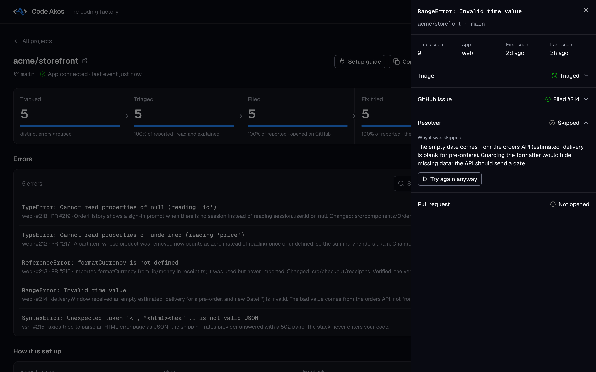
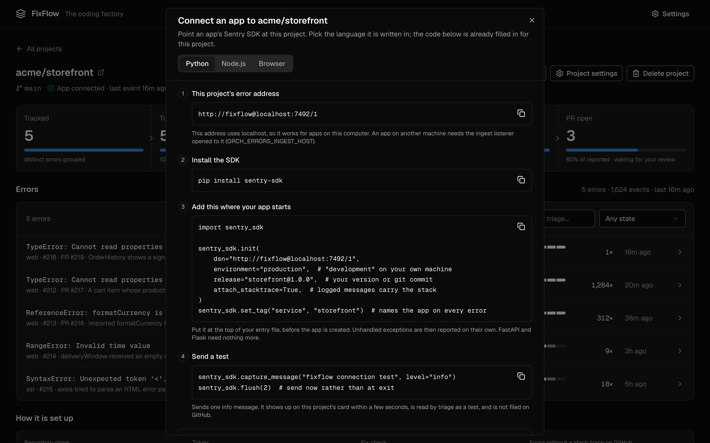

## How an error becomes a pull request

The model runs locally through Ollama (default `qwen2.5-coder:7b`) or through the DeepSeek or Anthropic API. Nothing else needs to run: no Docker, no Postgres, no queue.

<div class="grid cards" markdown>

-   <span class="ff-step">1 · Ingest</span>

    Sentry's `store` and `envelope` endpoints on `127.0.0.1:3000`. Your app only changes its DSN.

-   <span class="ff-step">2 · Group</span>

    By exception type, crashing file and that frame's source line, so ids in messages and shifted line numbers don't split a group.

-   <span class="ff-step">3 · Triage</span>

    A model, or built-in rules when none is set up, says what happened and tags it `bot-safe`, `needs-human`, `infrastructure` and so on.

-   <span class="ff-step">4 · File</span>

    One GitHub issue per new group with a stack trace, with a comment at 100, 1,000 and 10,000 events.

-   <span class="ff-step">5 · Resolve</span>

    The model edits a throwaway worktree, your check command runs before and after, and a pull request is opened against your branch.

-   <span class="ff-step">Or skip</span>

    When the cause isn't in the code (a database that is down, a bad secret), the resolver says so instead of guessing.

</div>

The resolver does not read triage tags yet; it attempts every open issue FixFlow filed.

## In the dashboard

<div class="grid cards ff-shots" markdown>

-   

    **Every project at a glance.** Tracked, triaged, filed, fix tried and PR open, per project and in total.

-   

    **What triage found, and the fix.** What the model read, what the resolver changed, and the pull request.

-   

    **A skipped fix, explained.** Here the bad date comes from the orders API, so guarding the formatter would only hide it.

-   

    **Connecting an app.** The setup guide fills in the DSN for each project, in Python, Node.js or browser code.

</div>

The desktop app for macOS sets everything up in four steps and checks each one before you continue. More screenshots are in [the repository](https://github.com/Ayesh96/FixFlow/tree/main/docs/assets/screenshots).

## Quick start

Needs Node 24+ and git, on Linux or macOS.

```bash
git clone https://github.com/Ayesh96/FixFlow.git && cd FixFlow
npm install
npm start
```

The first `npm start` in a terminal runs a short setup: dashboard port, data folder, at least one model (it tests Ollama and verifies API keys, and lists only the models they have), and the error-tracking and resolver settings. It checks the ports are free and runs everything through the server's own config checks before it writes `.env`. Run `npm run setup` to change the settings later; it starts from the current `.env`.

Open the printed `http://localhost:7420/?token=…` link once. Add a project on the **Projects** tab (repository, GitHub token, branch) and set your SDK's `dsn` to the project's DSN, for example `http://fixflow@localhost:3000/1`. From another terminal, `curl http://localhost:3000/healthz` should answer `200`.

## Guides

<div class="grid cards" markdown>

-   [**Self-hosted error tracking**](self-hosted-error-tracking.md)

    Processes, ports, files, what leaves the machine.

-   [**Sentry alternative**](sentry-alternative.md)

    What it replaces, and a comparison with Sentry, GlitchTip and Bugsink.

-   [**Sentry errors to GitHub issues**](sentry-errors-to-github-issues.md)

    Grouping, filing rules, issue contents, token permissions.

-   [**AI fixes as pull requests**](ai-bug-fix-pull-requests.md)

    Which issues are attempted, the agent loop, retries, cost.

-   [**Error triage with Ollama**](local-llm-error-triage.md)

    Tags, the prompt's definition of a small fix, guardrails.

-   [**Reference**](reference.md)

    Every setting and the security model.

</div>

## Limits

Errors only: no tracing, session replay or alert rules. One user, loopback by default. Windows untested. Fix success rate not measured. Source-available under FSL-1.1-ALv2, not an OSI open-source license.
